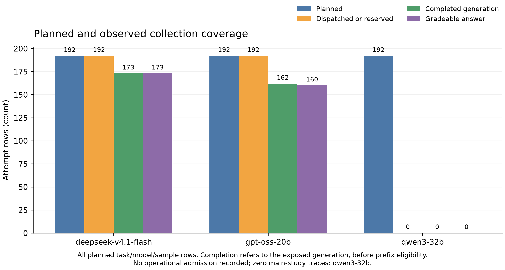
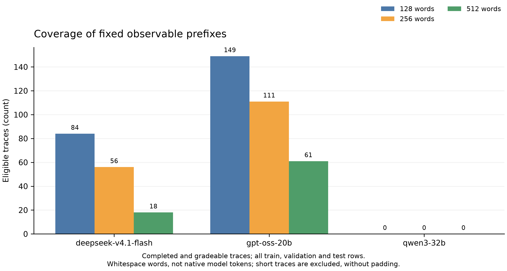
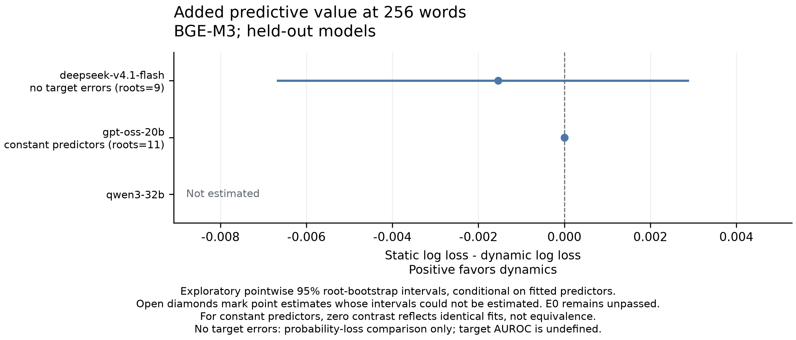
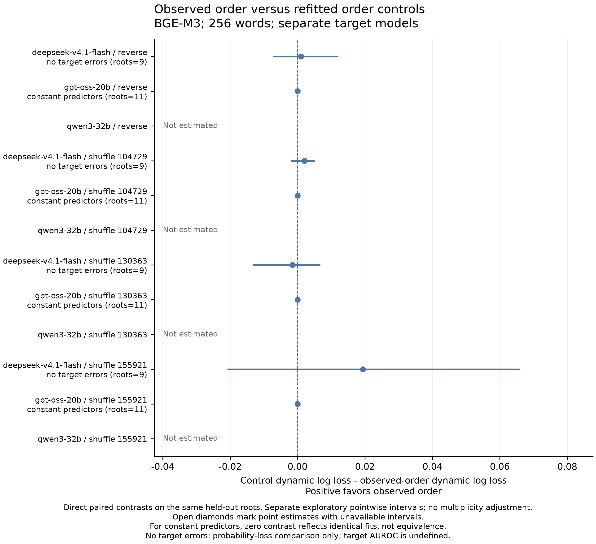

# Observable Reasoning Prefixes Under Model Holdout: A Ceiling-Limited Pilot

Exploratory technical research report. 8 November 2026. Independent human scientific review remains pending.

## Abstract

The primary error-discrimination question in this pilot remains unidentified by the achieved class support. We studied whether ordered features of externally visible reasoning text improve prediction of final-answer correctness beyond task attributes, lexical dynamics and pooled content under model and task-root holdout. The admitted allocation produced 384 saved attempts on 96 tasks from four programmed domains. Of 335 completed visible traces, 333 were gradeable: 329 correct and four incorrect. At the specified 256-word BGE-M3 comparison, holding out DeepSeek evaluated 20 correct answers and no errors; holding out GPT-OSS trained on 25 correct answers and no errors, invoking identical constant predictors. DeepSeek's equal-root static-minus-dynamic log-loss gain was -0.00154, with a conditional pointwise 95% interval [-0.00669, 0.00290]. GPT-OSS's algebraic zero contrast reflects the constant fallback. These are probability-score comparisons, not evidence of a transferable error detector, practical equivalence or absence of dynamic information. Both semantic embedders covered all requested chunks, and matched-sample refits reproduced their corresponding original predictions. Secondary results, direct refitted-order controls, exclusions and operational amendments are retained. The study identifies an evaluation bottleneck: feasibility-balanced tasks and fixed prefixes need not supply informative completed errors. Functional-state validation and stopping interventions remain unresolved.

## Research question and scope

Externally visible reasoning is an accessible channel for monitoring model behavior. A trajectory through a text representation may nevertheless reflect lexical repetition, task composition, formatting or the measurement operator rather than transferable information about successful reasoning. We asked whether a specified family of ordered text features adds correctness information after those alternatives are represented in the baseline, with the target model and test-task roots excluded from fitting.

The distinction between probability scoring and error discrimination is decisive here. Log loss compares assigned probabilities even on an all-correct target sample, but that sample cannot identify error-ranking AUROC. A single-class source can support a prescribed constant predictor without learning how errors differ from successes. Achieved class support therefore determines what the numerical contrast can answer before any interpretation of geometry.

This report presents a narrow predictive pilot and its limits: an auditable collection and eligibility record, source-only fits with content-preserving refitted controls, and a diagnosis of why the primary evaluation did not identify a transferable error discriminator. It is not a completed universal-reasoning study. The original H0-H7 hypotheses remain unchanged. E0, the broader program's independent human-reference measurement gate, remains unpassed; no functional role labels or internal cognitive states are inferred here.

## Related work

Reasoning-state abstraction already has close precedents. Yu et al. represent steps through spectral features, cluster them, and analyze Markov transitions [1]. Shahariar et al. combine a six-state abstraction with activation steering [2]. These studies preclude treating a state graph alone as a contribution. Our narrower question concerns the incremental predictive information obtained from an external text measurement under explicit controls.

Temporal prediction is also established. Chrabąszcz et al. extract trajectories from hidden-state probes and distinguish in-distribution separability from transfer [3]. Their revised analysis reports that evaluation-distribution fitting and classifier selection changed earlier transfer conclusions. Harrasse et al. study activation-derived regimes with correctness and temporal controls, including permutation before dynamics fitting, and examine interventions [4]. The present pilot instead uses observed text; this difference does not establish superiority or validate text geometry as a functional ontology.

Prediction and intervention require separate evidence. Dong, Qin and Shah compare stopping policies at matched lost-correct risk while accounting for probe and serving overhead [5]. An observational gain here cannot establish deployable savings. Liu et al. evaluate CoT pathologies using interventions and model organisms, while noting family-dependent intervention shifts and limits of the healthy-reference assumption [6]. Repetitive or unusual text alone therefore does not diagnose pathology. The same-owner Semantic Afterlife audit supplies lessons about repetition, missingness and measurement sensitivity, rather than independent support for this cohort [7].

## Study design and operational collection

The prospective corpus contains 96 main tasks grouped into 48 paired roots. Exact arithmetic, CNF satisfiability, topological ordering and bounded grid planning each contribute 24 tasks. The fixed split contains 48 training, 16 validation and 32 test tasks. Four additional admission tasks are excluded from predictive evaluation. Root pairs, repeated generations and observations from different models retain the same split. Canonical checks reject exact normalized duplicates without proving absence of algebraic equivalence or graph isomorphism. Named generator variants are not certified independent task families, and input-size schedules are not calibrated model difficulty.

Correctness is determined by a separate versioned verifier: arithmetic recomputation, exhaustive Boolean assignments, independent topological search, or bounded planning with full simulation. Responses require a final nonempty `ANSWER:` line. Unparseable answers and unavailable grading are recorded explicitly. Task feasibility is distinct from model-answer correctness; balancing feasible and infeasible instances does not balance the model's outcomes. The verifier and its source hash accompany the observations.

The candidate model identities are Qwen3-32B, DeepSeek-V4.1-Flash and GPT-OSS-20B, accessed through RouterAI. Candidates are not automatically admitted or replaced. Operational admission requires the exact returned model and provider, a completed exposed reasoning channel, and no summary-only, encrypted or truncated substitute. The admitted route is pinned without fallback; subsequent drift is retained as an exclusion. Admission is an access check, not proof of complete or faithful internal reasoning. Unknown weight revisions, quantization and execution details remain unknown.

The local v2 plan requested two samples per task, temperature 0.7, top-p 0.95 and at most 4096 output tokens, with maximum concurrency three and no automatic retries. A deterministic queue preserves planned root/model/sample coverage without outcome-based selection. Raw requests, responses, failure statuses, identities and accounting survive unsuccessful attempts. Pricing is reserved before dispatch using conservative explicit rates; actual accounting is reported separately below.

The source snapshot was committed as `fcd4426` before the first paid admission request. The [local v2 plan](../design/LOCAL_PILOT_2026_11_08.json) is a locally timestamped development analysis plan, not an external preregistration, G2 protocol freeze or scientific approval. Actual admission and collection counts below distinguish the prospective candidate matrix from what was dispatched.

## Observable prefixes and representation

Predictor inputs contain the reasoning channel only, censored before the first `ANSWER:` marker. Budgets are 128, 256 and 512 Unicode non-whitespace spans, termed *whitespace words*. They are not model-native tokens or percentages of eventual completion length. Each prefix consists of exact consecutive 16-word chunks with original character offsets and input hashes. Construction excludes future total length and the separate API answer channel; conclusions already in reasoning may remain.

Eligibility requires a completed, gradeable observation that reaches the requested budget. Short traces are not padded. Semantic analysis additionally requires valid embeddings for every exact chunk. Consequently the estimand conditions on completion, grading, prefix availability and, where applicable, embedding availability. These conditions may depend on correctness or model identity. Coverage and class counts must therefore accompany performance by model, domain, split and outcome; the eligible sample does not represent all attempted queries automatically.

The lexical representation uses unigram TF-IDF. Semantic representations are BGE-M3, requiring 1024 dimensions, and Qwen3-Embedding-8B, permitting up to 4096 dimensions with a constant admitted dimension. Each chunk is embedded alone, without later context. Returned identity, nonzero finite vectors, exact text, character boundaries and hashes are checked. Raw provenance binds these checks to the external responses, although a returned identifier cannot independently establish backend weights.

TF-IDF vocabulary and inverse-document frequencies are fitted only on source training prefixes. Chunks containing no source-vocabulary terms remain zero vectors; they are neither filled from target data nor silently excluded. Each fold reports their frequency and the number of affected or entirely zero traces. The implementation's zero-vector cosine convention can influence lexical geometry, so out-of-vocabulary coverage is a measurement limitation, not a semantic similarity claim. Valid semantic zero vectors are rejected separately.

At the primary budget, both transfer directions recorded zero source-vocabulary zero chunks in training, validation and testing. The OOV convention therefore does not explain the primary class-support bottleneck.

## Predictors and model holdout

For each target identity, source training roots from the other models fit the representation and classifier. Source validation roots select regularization; the target is evaluated on its test roots. Test roots are absent from training and validation across all models. Vocabulary, numeric scaling, category encoding and classifier fitting exclude the target model. This is checkpoint or model holdout. A family-generalization interpretation additionally requires evidence that no related training lineage remains among the sources; model names alone cannot establish that independence. The test roots are new instances of the programmed distributions, not an unseen benchmark.

Three nested predictors use root-balanced training weights. The metadata predictor includes domain/difficulty encoding and seven surface statistics: character length, digit and punctuation rates, newline rate, type-token ratio, and fixed uncertainty/correction lexicon rates. The static predictor adds source-trained prefix TF-IDF and mean chunk content. In the semantic analysis it also adds the mean normalized semantic vector **and observed lexical-path geometry**. The dynamic predictor then adds semantic-path features. Thus the semantic contrast tests semantic geometry beyond lexical dynamics and pooled content; “static” does not mean that all temporal features are absent. In the lexical experiment, the dynamic addition concerns TF-IDF geometry alone.

The eleven geometric summaries are adjacent cosine-distance mean, standard deviation and slope; mean lag-two distance; endpoint cosine distance; Euclidean endpoint displacement divided by path length; mean cosine between consecutive increments; the fraction of nonadjacent pairs within cosine distance 0.1; mean nearest nonadjacent past distance; early-versus-late centroid distance; and the slope of distance from the initial chunk. They are descriptive path statistics rather than validated reasoning phases. Vectors are row-normalized, and slopes use equally spaced normalized chunk positions.

Each predictor uses logistic regression with regularization selected from C = 0.01, 0.1 and 1.0 by equal-root source-validation log loss. Fitting is repeated on the source training data at the chosen C, without adding validation observations. A one-class training sample uses an explicitly flagged, smoothed constant predictor. A one-class target has undefined AUROC, retained as missing. Empty training, validation or test subsets yield an unavailable fold rather than a successful evaluation. Per-fold manifests record fit roots/models, vocabulary, scaling, selected regularization and predictions.

## Estimands and uncertainty

The principal reported comparison is static-minus-dynamic binary log loss at 256 words with BGE-M3, separately for every held-out model. For each original test root, paired loss differences are averaged over its eligible attempts; these root means then receive equal weight. Positive gain favors the dynamic addition. Brier improvement, AUROC, other prefix budgets, Qwen embeddings, lexical geometry and pooled summaries are secondary exploratory outputs. All target-specific contrasts are retained, because pooling can hide opposite model effects.

The uncertainty calculation draws 2000 bootstrap samples of the original root means with replacement and reports percentile 95% intervals. A root drawn multiple times contributes with its multiplicity; it is not relabeled as a new independent task. Repeats and model observations within a root remain dependent. One root permits a descriptive point estimate but no estimated between-root interval.

Intervals are pointwise and conditional on the fitted predictors and observed cohort. They omit uncertainty from training, regularization selection, model-population sampling and backend identity. The matrix is exploratory, without confirmatory multiplicity-adjusted inference. An interval containing zero neither accepts H0 nor establishes practical equivalence; an equivalence claim would require a justified prospective region and sufficient precision.

## Order and measurement controls

Controls reverse the chunk order or apply three deterministic within-trace permutations with seeds 104729, 130363 and 155921. Each preserves chunk content/count and pooled static information. The affected source pipeline is refitted, regularization is selected on source validation, and the corresponding transformed target paths are evaluated. Shuffling only test inputs would introduce a different distribution shift and is not the control used here. For semantic analysis, observed lexical geometry stays in the baseline while the added semantic geometry changes order.

Direct contrasts pair each refitted control's dynamic loss with observed-order dynamic loss on the same trace/root, then use equal-root aggregation and root uncertainty. Positive values favor observed order. Separate static-to-dynamic intervals under two orders do not test their difference. The three shuffle results are reported separately, not treated as independent replications.

The primary BGE population remains unchanged by alternate-embedder availability. Supplementary matched analyses intersect exact eligible trace/prefix identities **before** all training, validation and test fitting, refit each pipeline on that common population, and report exclusions. This isolates a comparison on observed common support; it does not recover missing embeddings or remove selection bias. Agreement between operators is a robustness check, not human construct validation.

Both operators covered every requested chunk in the completed-trace population. All 15 matched runs per operator reproduced the corresponding original fits, predictions and target gains exactly; [the comparison record](../artifacts/resumption-2026-11-08/local/tables/matched-embedding-check.json) retains these checks. This agreement reflects complete common coverage, not a new independent replication.

## Collection and answer diagnostics

The main collection closed at 09:37:58 UTC on 8 November 2026. All 384 requests in the admitted allocation produced saved attempt records: 96 tasks, two requested samples, and two model identities. The corpus contains 48 paired task roots and four additional admission tasks. The three-candidate design contained another 192 Qwen3-32B cells, which were not dispatched after the finite admission rule rejected two output-length-limited responses. These absent cells are an admission outcome, not measured Qwen accuracy.

| Model and observed route | Main attempts | Completed visible traces | Truncated or excluded | Gradeable answers | Correct | Incorrect |
|---|---:|---:|---:|---:|---:|---:|
| DeepSeek-V4.1-Flash, BytePlus | 192 | 173 | 19 | 173 | 172 | 1 |
| GPT-OSS-20B, DeepInfra | 192 | 162 | 30 | 160 | 157 | 3 |
| Admitted allocation total | 384 | 335 | 49 | 333 | 329 | 4 |



Figure 1. Planned, dispatched, completed and gradeable main observations by model. DeepSeek and GPT-OSS each have 192 saved attempts, with 173 and 162 completed visible traces; GPT-OSS has two further grading failures. Qwen3-32B's 192 main cells remain unsent after admission failure. Missing cells and truncations are availability outcomes, not measured incorrect answers or evidence of zero model accuracy.


The 329/333 proportion describes gradeable completed answers. It is not an unconditional accuracy estimate over the attempted matrix, and neither 333 answers nor their segments are independent task roots. All 49 excluded main attempts reached the output limit. The exclusions were concentrated in logic: 43 of 96 logic attempts were truncated, compared with six of 96 planning attempts and none in arithmetic or topological ordering. Two completed arithmetic answers additionally failed the fixed response parser. The full model/domain/split matrix, including the unadmitted candidate's unsent cells, is retained in the [coverage tables](../artifacts/resumption-2026-11-08/local/tables/coverage.md).

These counts expose an evaluation bottleneck. Balancing satisfiable and unsatisfiable instances, or feasible and infeasible plans, does not balance model correctness. The completed, gradeable population contains only four errors, and completion itself depends strongly on the observed domain. Increasing apparent accuracy by conditioning on completion would obscure this selection. Conversely, treating every missing answer as a measured incorrect label would change the specified prediction target. We preserve the original labels and report availability separately.

### Separate checks of the observed errors

Every recorded incorrect answer was checked with a separate deterministic implementation that does not import the main `verify_answer` function. The [diagnostic code](../scripts/audit_local_errors.py), [certificates](../artifacts/resumption-2026-11-08/local/error-audit.json), and [audit report](../reports/LOCAL_ERROR_AUDIT.md) retain task data, exact submitted answers, input hashes, and the checker hash. This is a postcollection program check of selected error records; it is not an independent human scientific review or a second hypothesis test.

The DeepSeek error answered `SAT` for an eight-variable CNF. Exhaustive evaluation rejected all 256 assignments. A separately checked resolution derivation also reached the empty clause. The three GPT-OSS errors violate explicit grid constraints: one test answer moves north from the origin to `(0,-1)`, one training answer leaves the grid at `(5,-1)`, and another enters an obstacle at `(4,2)` on its eighth move. An independent breadth-first search found valid routes of nine, ten, and eight moves for the corresponding planning problems, and those witnesses were simulated again. The diagnostic therefore supports the four local error labels; it does not validate every aspect of the task distribution.

The two unparseable GPT-OSS arithmetic outputs ended with `**ANSWER: 44**` and `**ANSWER:** 32`. Removing Markdown emphasis yields numbers that satisfy their respective remainder constraints. The fixed parser requires the exact final-line format, so both original labels remain `null` and neither enters the gradeable prediction sample. This distinction matters when correctness errors are rare: formatting failures, unsuccessful reasoning, and incomplete generations are different observations.

### Consequences for the predictive question

At the predeclared 256-word budget, text eligibility yields the following support before embedding exclusions. The [programmatically generated support table](../artifacts/resumption-2026-11-08/local/tables/prefix-support.md) retains all three budgets.

| Model | Split | Eligible traces | Roots | Correct labels | Incorrect labels |
|---|---|---:|---:|---:|---:|
| DeepSeek-V4.1-Flash | Train | 25 | 14 | 25 | 0 |
| DeepSeek-V4.1-Flash | Validation | 11 | 5 | 11 | 0 |
| DeepSeek-V4.1-Flash | Test | 20 | 9 | 20 | 0 |
| GPT-OSS-20B | Train | 60 | 20 | 58 | 2 |
| GPT-OSS-20B | Validation | 17 | 6 | 17 | 0 |
| GPT-OSS-20B | Test | 34 | 11 | 33 | 1 |

Consequently, neither transfer direction supplies both a source training sample with errors and a target sample with errors. Holding out GPT-OSS trains on a single-class DeepSeek sample, invoking the specified constant-predictor fallback. Holding out DeepSeek evaluates a target containing only correct answers, making error-ranking AUROC undefined. Both source-validation samples also contain no errors. This is a limitation of the achieved evaluation population, not evidence that ordered text features contain no information.

The sole DeepSeek error has 226 retained whitespace words. It qualifies at 128 words but is excluded by the predeclared 256-word primary budget. The budget is retained; moving the primary analysis to a shorter prefix after seeing this error would change the design. The 128-word analyses remain reported secondary results, where one error root still provides little support for a robust detector claim.



Figure 2. Completed, gradeable traces reaching each fixed prefix budget across all splits. DeepSeek contributes 84, 56 and 18 traces at 128, 256 and 512 words; GPT-OSS contributes 149, 111 and 61. These totals are dependent observations, not independent roots. Prefix eligibility excludes the 226-word DeepSeek error from the primary budget. Primary test subsets contain no DeepSeek errors and only one GPT-OSS error; both source-validation subsets are all correct.

## Primary predictive result

The primary reporting contrast is the equal-root mean of static-minus-dynamic log loss at 256 observed whitespace words with BGE-M3, separately for each held-out model. Positive values favor the dynamic addition. All 5,778 requested BGE chunks from the 335 completed visible traces were covered by accepted DeepInfra responses. Prefix and grading eligibility therefore determine the final primary sample: 20 DeepSeek test traces from nine roots and 34 GPT-OSS test traces from 11 roots. The [saved analysis](../artifacts/resumption-2026-11-08/local/analysis-bge.json) contains every prediction, source-fit fingerprint, regularization choice and control.

| Held-out model | Test traces / roots | Static log loss | Dynamic log loss | Gain | Pointwise 95% root interval |
|---|---:|---:|---:|---:|---|
| DeepSeek-V4.1-Flash | 20 / 9 | 0.53152 | 0.53306 | -0.00154 | [-0.00669, 0.00290] |
| GPT-OSS-20B | 34 / 11 | 0.11179 | 0.11179 | 0.00000 | [0.00000, 0.00000] |

The DeepSeek point estimate favors the static predictor slightly. Its interval includes gains of either sign and conditions on the fitted source models. Since the target contains only correct answers, this comparison scores probabilities assigned to positive observations; it cannot measure error-ranking AUROC or validate calibration across a population containing failures.

In the GPT-OSS direction, all 25 eligible DeepSeek training observations are correct. The predefined procedure consequently returns the same smoothed constant predictor for metadata, static and dynamic inputs. The zero contrast and zero-width interval follow from identical fitted predictions. They are not evidence of practical equivalence, absent dynamic information, or acceptance of H0. GPT-OSS has one error among its 34 eligible target traces; a constant score has AUROC 0.5, but no transferable error discriminator was learned in this fold.

The achieved experiment therefore provides no convincing primary evidence for incremental error prediction by these features. More specifically, the primary discrimination question lacks the required class support in opposite sides of the two transfer directions. This is a restriction on inference from this pilot, not an estimate of a universal absence of useful reasoning dynamics.

At 256 words, the prespecified metadata/surface baseline has DeepSeek log loss 0.10952 and Brier 0.01720, compared with static log losses 0.28643 for lexical features, 0.53152 for BGE and 0.79139 for Qwen. Richer features assign worse proper scores on these all-correct observations; this does not establish broader calibration. All method scores remain [available](../artifacts/resumption-2026-11-08/local/tables/all-method-metrics.csv). The specified primary comparator is retained, rather than replaced after observing these results. GPT-OSS uses identical constant predictors for every method.



Figure 3. Primary BGE-M3/256-word equal-root static-minus-dynamic log-loss differences; positive favors dynamics. DeepSeek uses 20 target traces from nine roots and has no target errors, making AUROC undefined. GPT-OSS uses 34 traces from 11 roots, but its source lacks errors, so identical constant predictors force a zero difference and interval. Error bars are conditional pointwise 95% intervals from 2000 root-bootstrap draws, not training uncertainty or an equivalence test. Qwen3-32B remains unestimated after admission failure.

## Direct order controls

Each control refits the affected source pipeline and compares its dynamic predictor directly with the observed-order dynamic predictor on the same target traces and roots. The contrast below is control dynamic loss minus observed dynamic loss; positive values favor the observed order. These are separate exploratory comparisons with conditional pointwise intervals.

| Control | DeepSeek loss gain | DeepSeek 95% root interval | GPT-OSS loss gain |
|---|---:|---|---:|
| Reverse | 0.00103 | [-0.00733, 0.01206] | 0.00000 |
| Shuffle 104729 | 0.00208 | [-0.00186, 0.00507] | 0.00000 |
| Shuffle 130363 | -0.00149 | [-0.01319, 0.00676] | 0.00000 |
| Shuffle 155921 | 0.01936 | [-0.02083, 0.06595] | 0.00000 |

Every displayed DeepSeek log-loss interval spans zero. GPT-OSS remains at the constant-predictor fallback, so its direct contrasts are algebraically zero. These comparisons do not establish ordering-dependent error prediction. Other scoring rules are retained rather than used to replace the primary metric: the last shuffle comparison has an exploratory Brier gain of 0.01081 with interval [0.00149, 0.02697], while its log-loss interval spans zero. That result concerns probabilities on the all-correct DeepSeek target and does not supply evidence of a robust failure detector.



Figure 4. Direct refitted control-versus-observed dynamic log-loss differences at BGE-M3/256 words, on the same target traces and roots as Figure 3. All four DeepSeek intervals span zero and its target has no errors. GPT-OSS comparisons are zero because its source lacks errors and every fit uses the constant fallback. Intervals are separate conditional pointwise 95% root-bootstrap intervals without multiplicity adjustment. Three shuffle seeds are controls, not independent replications.

## Alternate measurement and secondary budgets

At 256 words with Qwen3-Embedding-8B, DeepSeek's static and dynamic log losses are 0.79139 and 0.79397: gain -0.00259 [-0.00700, 0.00138]. GPT-OSS again uses the identical constant fallback. This supports the same limited interpretation on the matched eligible observations. One alternate-measurement order comparison favors observed order: shuffle 155921 gives a DeepSeek log-loss gain of 0.03497 [0.01145, 0.06135]. It remains a secondary pointwise probability-score result on an all-correct target, not a validated detector claim.

Other budgets contain favorable and unfavorable probability-score contrasts, all retained. At 128 words, DeepSeek's BGE gain is 0.00752 [0.00202, 0.01313], but its target still has no errors. GPT-OSS's BGE gain is 0.00977 [-0.00282, 0.02353], with one training error in its DeepSeek source and one target error. Lexical 128-word contrasts have positive intervals in both directions; these sparse outcomes do not establish reliable error discrimination. At 512 words, BGE gives DeepSeek 0.03417 [0.01674, 0.05605] on nine correct traces from four roots, while Qwen gives -0.00625 [-0.04124, 0.03255]. Measurement choice and the small conditional population materially limit interpretation.

The [complete observed table](../artifacts/resumption-2026-11-08/local/tables/observed-secondary.md) reports all 18 original observed-order contrasts, including Brier and constant flags. Machine-readable [observed contrasts](../artifacts/resumption-2026-11-08/local/tables/observed-contrasts.csv), [all methods](../artifacts/resumption-2026-11-08/local/tables/all-method-metrics.csv) and [all order controls](../artifacts/resumption-2026-11-08/local/tables/all-order-contrasts.csv) also preserve matched analyses and every ordering. These tables report existing outputs without refitting or redefining the estimand.

## Operational amendments and accounting

API compatibility required disclosed operational amendments after main collection and lexical diagnostics but before semantic fitting. Two initial responses returned `BAAI/bge-m3` and `Qwen/Qwen3-Embedding-8B`, differing from requested identifiers only in ASCII case. A separate casefold-only amendment preserved raw IDs and frozen core bytes; aliases and whitespace normalization remained forbidden. Subsequent unpinned batches exposed route drift: a BGE response used an unconfirmed Parasail alias and a Qwen response came from Nebius. Both HTTP-200 responses and their costs remain in the journal as rejected measurements.

The [new provider condition](../design/LOCAL_EMBEDDING_PINNED_2026_11_08.json) prospectively pinned DeepInfra without fallback. Its collector, condition hash, original-to-paid mapping, pre-reservation intents and acceptance receipts are separately bound. Three known valid DeepInfra batches were reused offline without resending, while two rejected routing batches were retained. New requests used identical chunk texts and offsets under the explicit new routing condition and shared ledger. No unknown attempt was silently retried. This was a technical change informed by observed API behavior, not blind external preregistration; it did not change the original 335-trace population, analysis code or primary estimand.

The 758 new ledger rows comprise ten admission, 384 main-generation and 364 embedding attempts. Both embedders ultimately cover all 5,778 chunks. Monetary reporting distinguishes observed API charges from conservative obligations:

| Accounting quantity | RUB |
|---|---:|
| New API-reported charges | 22.26254 |
| New retained reservation above reported charges | 378.28070 |
| New commitments without reported cost | 4.17591 |
| New charged-or-reserved total | 404.71915 |
| Historical charged-or-reserved total | 246.79888 |
| Combined charged-or-reserved total / authorized ceiling | 651.51803 / 3000 |

The combined 651.52 RUB is not measured spending. New commitments sum reported charges, retained margin and amounts lacking reported cost; missing cost is not zero. The historical ledger prefix remains preserved. [The accounting record](../artifacts/resumption-2026-11-08/local/tables/summary.json) supports these distinct quantities.

## Interpretation and next evidence

The main limitations arise before any geometric interpretation. Only two model identities passed operational admission, trace completion varies by domain, and reaching a fixed prefix further selects the population. At the primary budget, source validation contains no errors in either direction. A model-held-out score cannot establish transfer to all architectural families, and new roots from the same programmed distributions do not establish a new task mechanism. Only four gradeable errors occurred in the full main collection; the primary populations retain even fewer.

The intervals describe resampling of observed target roots conditional on the learned representations, selected regularization and fitted classifiers. They omit uncertainty in source training, task-generator choice, model ancestry and external backend revisions. No minimum useful effect or equivalence margin was frozen for this development pilot. Non-rejection and an identical-predictor contrast therefore cannot establish H0. A single source checkpoint in each fold also leaves model-population uncertainty unresolved.

E0 remains unpassed. The study uses geometric features of an observed text channel and programmatically verified final answers; it does not validate functional role labels, faithful internal computation, shared cognitive states or causal overthinking. H7 includes a controlled stopping intervention and complete serving-cost evaluation, neither of which was performed. No human G3 or manuscript G4 approval is supplied by tests, AI-assisted audits, archive verification or an EpistemeOS mechanical stage.

A stronger subsequent study needs fresh development tasks that yield enough **completed** correct and incorrect answers, with coverage checked at each prospective prefix budget. Feasibility balance alone is insufficient, and simply increasing input difficulty can increase truncation instead of producing informative errors. Task difficulty and inference budget should be examined separately before a new held-out analysis is frozen. The present target sample must not become a tuning set for that next study.

## Reproducibility and contributions

Analysis version `observable-prefix-transfer-v1.1` and its source inventory are frozen with collection state. The portable bundle retains protocol/tasks, all attempts, cleaned original requests/responses, ledger, technical amendments, condition mappings, fit diagnostics, predictions, controls and manifest hashes. Shards avoid duplicating giant derived vector aggregates: exact records are reconstructed from saved vectors, completion inventories and raw hashes. Invalid or unfinished semantic modes are excluded as whole modes without fabricated vectors. Same-code replay is not new-data replication.

After installing `requirements-resumption.txt`, the free Windows replay command is:

```text
.venv/Scripts/python.exe -X utf8 scripts/reproduce_local.py --manifest evidence/local-pilot-2026-11-08/manifest.json --output .research/local-replay-check
```

The output directory must be new; replay uses no API and leaves the retained ledger unchanged. [Table generation](../scripts/build_manuscript_tables.py) and [figure generation](../scripts/plot_local_results.py) operate on saved outputs. The [claims-to-evidence map](../artifacts/resumption-2026-11-08/local/claims-to-evidence.json) connects numerical statements to artifacts. The local implementation suite passed 214 tests; tests and AI-assisted checks are not independent human review.

The separate [EpistemeOS check](../artifacts/resumption-2026-11-08/local/episteme-stage-result.json) captured 27 declared artifacts and completed 54/54 offline primary/reanalysis attempts, with zero failed or unknown attempts. Mechanical stage criteria were met; the outcome remained exploratory/inconclusive, scientific validity unassessed and review unrequested. [Backup restoration](../artifacts/resumption-2026-11-08/local/episteme-backup-check.json) preserved 340 events and the graph hash. These checks do not certify collection completeness, statistical correctness or human approval.

The repository owner supplied the research objective, recorded design choices and execution authorization. Codex and autonomous programming assistants performed substantial implementation, testing, source review, analysis preparation and drafting. Program audits are AI-assisted checks, not independent human scientific review. Repository ownership does not imply unaided execution of every artifact or establish personal leadership experience. This technical draft does not claim journal readiness or acceptance, and no article or Residency application is submitted.

## References

1. Yu et al. *Explainable Chain-of-Thought Reasoning: An Empirical Analysis on State-Aware Reasoning Dynamics*. [arXiv:2509.00190v2](https://arxiv.org/abs/2509.00190v2).
2. Shahariar et al. *Modeling Hierarchical Thinking in Large Reasoning Models*. [arXiv:2510.22437v2](https://arxiv.org/abs/2510.22437v2).
3. Chrabąszcz et al. *Monitoring the Internal Monologue: Probe Trajectories Reveal Reasoning Dynamics*. [arXiv:2605.18549v2](https://arxiv.org/html/2605.18549v2), especially sections 2-3.3 and Appendix O.
4. Harrasse et al. *Reasoning Fine-Tuning Induces Persistent Latent Policy States*. [arXiv:2607.18532v1](https://arxiv.org/html/2607.18532v1), especially sections 5.2/8 and Appendix E.2.
5. Dong, Qin and Shah. *When Does Learning to Stop Help? A Cost-Aware Study of Early Exits in Reasoning Models*. [arXiv:2606.30852v2](https://arxiv.org/abs/2606.30852v2).
6. Liu et al. *Diagnosing Pathological Chain-of-Thought in Reasoning Models*. [arXiv:2602.13904v2](https://arxiv.org/html/2602.13904v2), especially sections 3 and 6.
7. Reasoning Universalis. [Semantic Afterlife transfer audit](../reports/SEMANTIC_AFTERLIFE_TRANSFER.md), 8 November 2026; same-owner source audit, not independent replication.
