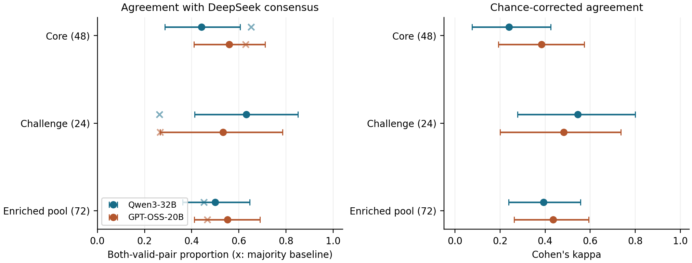
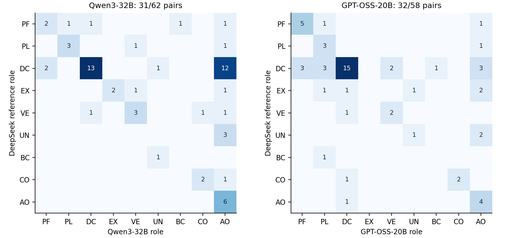
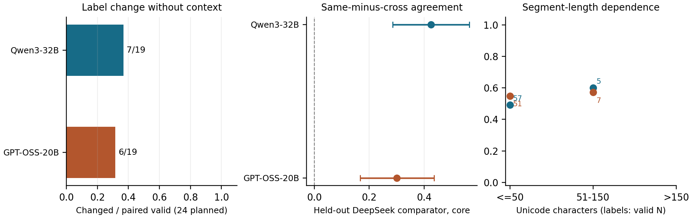

# Cross-family portability of visible-reasoning role labels

Exploratory measurement pilot | 15 November 2026 | 24 development task roots

## Question and design

Do functional role labels survive a change of annotation instrument? We reuse a frozen nine-role ontology and 72 published segments: a label-blind 48-item core (two per root) plus a separately reported 24-item challenge sample (one per root) enriched for rare prior machine labels and unresolved cases. The pool covers four task domains and two source-generator models. Existing DeepSeek multiseed consensus is a comparison instrument, never ground truth.

Qwen3-32B and GPT-OSS-20B are pinned to DeepInfra through RouterAI. Each receives the original task, current segment and allowed past context, without source identity, previous labels, correctness or future text. A paired context-removal condition uses one hash-selected core segment per root (24 per model). All 200 parent items contain context; there is no observational no-context comparison.

## Results

| Instrument | Sample | Matches / valid / planned | Raw agreement [95% root CI] | Cohen kappa [95% root CI] | Majority baseline |
|---|---|---:|---|---|---:|
| Qwen3-32B | core | 19 / 43 / 48 | 0.442 [0.286, 0.605] | 0.240 [0.075, 0.425] | 0.651 |
| Qwen3-32B | challenge | 12 / 19 / 24 | 0.632 [0.412, 0.850] | 0.545 [0.278, 0.800] | 0.263 |
| Qwen3-32B | pooled | 31 / 62 / 72 | 0.500 [0.362, 0.645] | 0.394 [0.238, 0.558] | 0.452 |
| GPT-OSS-20B | core | 24 / 43 / 48 | 0.558 [0.409, 0.711] | 0.383 [0.193, 0.573] | 0.628 |
| GPT-OSS-20B | challenge | 8 / 15 / 24 | 0.533 [0.267, 0.786] | 0.483 [0.200, 0.736] | 0.267 |
| GPT-OSS-20B | pooled | 32 / 58 / 72 | 0.552 [0.411, 0.690] | 0.435 [0.262, 0.593] | 0.466 |

The primary result is limited transfer of this measurement configuration: both new instruments fall below their descriptive majority-label baseline on the core, despite positive chance-corrected agreement. The enriched challenge reverses the apparent ranking of the instruments, showing why a single pooled headline would be misleading.

Intervals resample complete task-root blocks with replacement (2,000 draws; seed 20261115). Invalid/new-missing and unresolved-reference cases remain in the planned denominator; both-valid agreement is accompanied by matches/all-planned in the machine-readable tables. `ambiguous_other` is a valid ninth category. Challenge and pooled estimates describe an enriched sample, not natural role prevalence.

## Role sensitivity and disagreements

| Prior machine role | Qwen matches / valid reference-role N | GPT-OSS matches / valid reference-role N |
|---|---:|---:|
| problem_formulation (planned N=7) | 2 / 6 | 5 / 7 |
| planning (planned N=6) | 3 / 5 | 3 / 4 |
| deduction_computation (planned N=29) | 13 / 28 | 15 / 27 |
| exploration (planned N=5) | 2 / 4 | 0 / 5 |
| verification (planned N=6) | 3 / 6 | 2 / 3 |
| uncertainty (planned N=3) | 0 / 3 | 1 / 3 |
| backtracking_correction (planned N=1) | 0 / 1 | 0 / 1 |
| conclusion (planned N=5) | 2 / 3 | 2 / 3 |
| ambiguous_other (planned N=6) | 6 / 6 | 4 / 5 |

The largest Qwen transition is prior deduction/computation to ambiguous/other (12/28 valid reference-deduction cases). GPT-OSS retains none of five valid prior exploration labels. These are instrument-dependent boundaries, not adjudicated annotation errors. Role-specific missingness matters: for example, only three of six prior verification items are valid GPT-OSS pairs; all six are valid Qwen pairs.

Examples are chosen mechanically from the three most frequent off-diagonal transitions per instrument; within each transition the lowest versioned hash is shown. They illustrate instrument disagreement and do not adjudicate which label is correct.

- Qwen3-32B: `deduction_computation` -> `ambiguous_other` (transition N=12; item `9011d971894d92884a8256e1`): \n39 [4,-1,5]: T.
- Qwen3-32B: `uncertainty` -> `ambiguous_other` (transition N=3; item `bd9748c5171f88440d7fef98`):  Goal maybe obstacle?
- Qwen3-32B: `deduction_computation` -> `problem_formulation` (transition N=2; item `96fb1344e0872442ed0a12f3`):  Row7 obstacle x=6.
- GPT-OSS-20B: `deduction_computation` -> `problem_formulation` (transition N=3; item `96fb1344e0872442ed0a12f3`):  Row7 obstacle x=6.
- GPT-OSS-20B: `deduction_computation` -> `planning` (transition N=3; item `236cdee54ecc637de41b9d04`): \n\nRemove 4 edges: 4->11, 4->2, 4->13.
- GPT-OSS-20B: `deduction_computation` -> `ambiguous_other` (transition N=3; item `9c823a69774c14ede200f7d4`):  That means start has only?

## Context and same-model controls

Qwen3-32B changes 7/19 paired-valid labels without past context (24 planned); full-minus-ablated agreement with the prior machine reference is 0.056. On 40 common valid core rows, held-out DeepSeek vote0 versus the other-four majority exceeds new-instrument agreement with that same reference by 0.425 (95% root CI [0.286, 0.564]).
GPT-OSS-20B changes 6/19 paired-valid labels without past context (24 planned); full-minus-ablated agreement with the prior machine reference is 0.105. On 40 common valid core rows, held-out DeepSeek vote0 versus the other-four majority exceeds new-instrument agreement with that same reference by 0.300 (95% root CI [0.167, 0.436]).

Direct Qwen/GPT-OSS agreement on the core is 25/41 valid pairs, kappa 0.472. The held-out comparator excludes vote 0 from its own reference and requires at least 3 of 4 other votes; incomplete or tied panels stay unresolved. This avoids the circular control of comparing a vote with a consensus that includes it. It does not equate single-call and multiseed instruments.

Source-model, domain, segment-length, context-length and original-unanimity strata, per-role intervals, undefined bootstrap counts, all planned cells and exact quotes are supplied in the JSON/CSV artifacts. There is only one segment longer than 150 characters and neither instrument produces a valid pair for it; 71 of 72 contexts are at most 250 characters. Consequently length/context-length dependence is weakly identified here. One draw per context condition confounds context sensitivity with sampling variation.

## Technical outcome and limitations

The initial two constructed schema probes failed before any study segment was sent: DeepInfra Qwen rejected `uniqueItems` in its grammar; GPT-OSS rejected disabled reasoning. One immutable premeasurement transport addendum removed only the unsupported grammar keyword while retaining the complete local schema, and enabled mandatory low-effort GPT-OSS reasoning. The first scheduled study item admitted each route. No unsuccessful study item was repeated, no segment was added, and the original 194-call ceiling includes the failed probes. Raw error responses are retained.

A separate post-run output-contract audit finds that all 26 invalid outputs pass the supplied JSON schemas but fail additional unchanged local rules: 13 repeat the primary role in secondary_roles (Qwen 5, GPT 8), 12 quote text absent from the current segment (Qwen 5, GPT 7), and 1 uses the wrong evidence source ID (Qwen). The primary/secondary exclusion is not expressed in the supplied schema or explicitly stated in the system prompt; exact evidence matching is explicitly stated. This separates structured JSON compliance from admissible measurement evidence. No label is repaired or rescued from these invalid objects. All 192 raw-response replays reproduce the recorded status and vote exactly.

Active-condition technical statuses: {'invalid': 26, 'valid': 166}. Qwen has 65/72 valid full-context outputs and 20/24 valid ablations; GPT-OSS has 60/72 and 21/24, respectively. Four of 72 prior references are unresolved. Additional active-condition charged-or-reserved commitments: 89.72 RUB; plus the initial 0.91 RUB failed-probe reserve. Combined shared ledger: 2128.95 RUB. These conservative commitments retain unknown charges and exceed API-reported costs; they are not a final billing statement.

This is an exposed development sample with 24 root clusters, sparse roles and an enriched challenge portion. Estimates cannot establish ontology validity, correctness, human agreement, faithful internal states or broad model universality. There is no human gold and E0 remains unpassed. Qwen and GPT-OSS share a provider; DeepSeek used BytePlus. Provider weight revisions/quantization are unknown. Structured decoding differs from the parent transport; GPT-OSS mandatory reasoning and model family are confounded. A weak result is evidence against immediate portability of this measurement configuration, not proof that functional structure does not exist.

## Reproduction and next study

Run `python scripts/reproduce_cross_model_compat.py` without an API key to check immutable inputs/raw responses and regenerate the primary analysis; `python scripts/tabulate_cross_model.py` writes the overall, role, source-model and prespecified-strata CSV tables, including intervals. `python scripts/audit_cross_model_outputs.py` reproduces the output-contract audit. Run `python scripts/render_cross_model_report.py` for figures and the three-page PDF. Tests cover unchanged parent data, Unicode offsets, whole-root bootstrap, invalid outputs, label leakage, reservations and no-repeat behavior.

The next study should first make every local output constraint explicit to all instruments, then freeze disputed role boundaries and collect genuinely independent human judgments plus repeated full/ablated annotations on the same roots. This separates contract compliance, instrument stochasticity, context sensitivity and codebook ambiguity before a larger confirmatory corpus. No E0 acceptance or generation-stage release follows from this pilot.

Model-license receipts: [Qwen official Apache 2.0 license](https://huggingface.co/Qwen/Qwen3-32B/raw/main/LICENSE), [GPT-OSS official Apache 2.0 license](https://huggingface.co/openai/gpt-oss-20b/raw/main/LICENSE). RouterAI route/capability/pricing receipts and the exact versioned source are archived.

Frozen scientific protocol: `design/CROSS_MODEL_PROTOCOL_2026_11_15.json`; transport addendum: `design/CROSS_MODEL_TRANSPORT_ADDENDUM_2026_11_15.json`. Complete inputs, raw calls, run metadata and tables: `artifacts/cross-model-compat-2026-11-15`.
